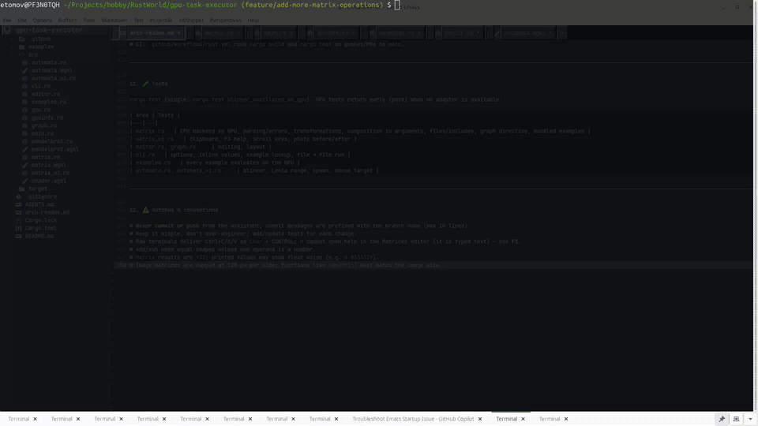

# gpu-task-executor

A Rust terminal UI (`ratatui`) that runs compute workloads on the GPU via `wgpu` (WGSL shaders).

<div align="center">
  
  <br>
  <sub>Demo session: matrix calculator, bundled examples, graph view and photo before/after.</sub>
</div>

## Features

- **Mandelbrot** – per-pixel iteration counts computed on the GPU; pan and zoom.
- **Game of Life** – rendered with braille characters (2x4 cells per character).
- **Lenia** – continuous cellular automaton rendered with half blocks (1x2).
- **Matrices** – open **Matrix examples** in the main menu (or `F2` in the Matrices screen) to load and run the bundled examples from `examples/` (Markov chains, graph search/adjacency, lighting and raycast, real-photo enhance/blur with before/after). Define matrices (`A = [1 2; 3 4]`) and compose operations in one expression, e.g. `(A + B) * C' - 2 * A`. Supports `+ - *` (matrix product; a number scales), `'` transpose, unary `-`, parentheses, and linear transformations as functions (angles in degrees, applied to column vectors): `rot(a)`, `rotx/roty/rotz(a)`, `scale(sx, sy[, sz])`, `shearx(k)`, `sheary(k)`, `identity(n)`, `reflect(a)` (mirror across the line at angle `a`), `proj(a)` (projection onto it), e.g. `rot(90) * v`; `det(M)`/`trace(M)` give numbers, and arguments may be any expression, e.g. `roty(det(A * B) + 10)`. Each step runs on the GPU.
- GPU info header on every screen, with NVML telemetry (sampled at most once per second; shows "unavailable" if NVML is missing).

Automata state stays on the GPU (ping-pong storage buffers) and is read back only for drawing. Grid size follows the terminal; resizing restarts the simulation.

## Requirements

- Rust (edition 2024 toolchain)
- A Vulkan/Metal/DX12-capable GPU and drivers
- Optional: NVIDIA driver for telemetry

## Install dependencies

1. Install Rust via [rustup](https://rustup.rs):
   ```sh
   curl --proto '=https' --tlsv1.2 -sSf https://sh.rustup.rs | sh
   rustup update stable
   ```
2. Install GPU drivers (Linux example, Debian/Ubuntu):
   ```sh
   sudo apt install build-essential pkg-config mesa-vulkan-drivers vulkan-tools
   vulkaninfo --summary   # verify a GPU is visible
   ```
   NVIDIA users should install the proprietary driver (also provides NVML for telemetry).
3. Cargo fetches the crate dependencies automatically on first build.

## Build

```sh
git clone <repo-url> && cd gpu-task-executor
cargo build            # debug
cargo build --release  # optimized
```

## Usage

```sh
cargo run --release   # needs a real terminal
```

Keys (`F1` opens a help window on every screen):

| Screen | Keys |
|--------|------|
| Menu / Setup | `↑`/`k`, `↓`/`j`, `Enter`, `q`/`Esc` |
| Mandelbrot | arrows pan, `+`/`-` zoom, `r` reset, `q`/`Esc` back |
| Matrices | `Tab` switch field, arrows/Home/End move (Shift selects), `Ctrl+C`/`X`/`V`/`A` copy/cut/paste (system clipboard, falling back to an internal one)/select all, `Enter` (in expression) or `F5` calculate, `Ctrl+S` save input, `Ctrl+E` export a `graph NAME grid W` maze as a zip (maze/solution/discovery drawings, adjacency, A*/BFS vectors, input, result), `Ctrl+R` save result (as `result = [...]`), or put a line `output path` in the definitions to save the result there on every calculation, `Ctrl+O` open file, `PgUp`/`PgDn` and `Ctrl`+arrows scroll a large result, `F4` focuses the graph (arrows pan, `+`/`-` or `PgUp`/`PgDn` zoom, `0` reset, `F4`/`Esc` back; labels appear when zoomed in enough), `F3` opens the expression help (all operations; the expression box also lists them), `Esc` back. `I = image path.png` loads a photo as grayscale (`builtin:earth` is bundled); large results are shown as before/after pictures. A line `graph NAME` draws that square matrix as a 2D graph beside the result (force-directed layout, or `graph NAME grid W` to place node `i` at column `i % W`; vector results highlight nodes; grid graphs are drawn as mazes (magenta walls, nodes as dots) and show the longest path in green and dead ends in red, with result highlights in yellow; up to 1000 nodes). `M = maze W H [seed]` generates (W, H and seed may be numbers or 1x1 variables like `W = 21`, as may the grid width) a random maze adjacency matrix, and `astar(A, start, goal[, gridWidth])` / `bfs(A, start)` search a graph and return a node vector. A definitions line `include path` loads the matrices of another file; saved files keep the expression in a `# expr:` comment |
| Game of Life | left click spawns the selected pattern, `s` spawns it under the mouse pointer (random spot if outside the grid), `p` cycles patterns, `space` pause, `n` step, `+`/`-` speed, `r` restart |

## Command line (no UI)

The binary is `gtu`. Giving `--input`, `--expression` or `--output` evaluates a matrix expression on the GPU and exits; with no options the interactive UI starts. `gtu -h` shows the help.

```sh
gtu --list-gpus                                       # index: name (backend, type)
gtu -e 'identity(3)'                                    # inline: a value that is not a file is used as text
gtu -i 'A=1 2; 3 5' -e 'A * identity(2)'               # several matrices: separate with \n
gtu --list-examples                                      # bundled algorithms: number: title
gtu --example 2 [-o out.txt]                           # run one (number or title part); --show-example prints its input file
gtu -i a.txt -e s1.txt | gtu -i - -e s2.txt             # piping: output is "result = [..]", usable as next input
gtu -g 1 -i matrices.txt -e expression.txt            # run on GPU 1 (-g also selects the GPU for the UI)
gtu -i matrices.txt -e expression.txt -o result.txt   # write the result to a file
gtu -i matrices.txt -e expression.txt                 # print "result = [..]" to stdout
gtu -i matrices.txt -e expression.txt | gtu -i - -e next.txt   # pipe: use `result` in next.txt
echo "A * B" | gtu -i matrices.txt -e -               # expression from stdin
cat matrices.txt | gtu -e expression.txt              # definitions from stdin
```

If `--expression` is omitted, the `# expr:` line of the input file is used. Errors go to stderr with exit code 1.

## Tests

```sh
cargo test
cargo test blinker_oscillates_on_gpu   # single test
```

GPU tests pass early when no adapter is available.

## Layout

- `src/main.rs` – event loop and screens (Menu, Mandelbrot, Setup, Run)
- `src/gpu.rs` – shared device, queue and adapter info
- `src/mandelbrot.rs`, `mandelbrot.wgsl` – Mandelbrot compute
- `src/automata.rs`, `automata.wgsl` – Life and Lenia
- `src/matrix.rs`, `matrix.wgsl`, `matrix_ui.rs` – matrix expression parser, GPU ops, screen
- `src/automata_ui.rs` – setup form and run screen
