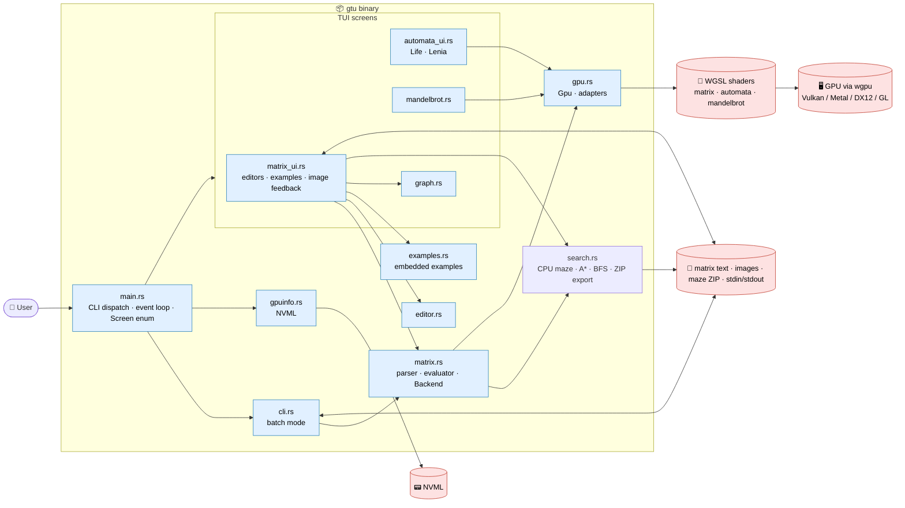

# 🏗️ Architecture & Source Map — GPU Task Executor (`gtu`)

-4285F4)

*In-depth map of the `src/` tree*

> [!NOTE]
> Build/test commands live in [`.github/copilot-instructions.md`](.github/copilot-instructions.md) and [`README.md`](README.md); assistant workflow guidance is in [`AGENTS.md`](AGENTS.md). The [README example catalog](README.md#bundled-examples) covers every bundled example; [`examples/README.md`](examples/README.md) maps their input and expression files.
> Paths below are relative to `src/` unless stated otherwise.

## 📑 Table of contents

1. [🎯 What this app is](#1--what-this-app-is)
2. [🧭 High-level architecture](#2--high-level-architecture)
3. [🚀 Startup & event loop](#3--startup--event-loop)
4. [🖥️ GPU layer](#4--gpu-layer)
5. [🧮 Matrix calculator](#5--matrix-calculator)
6. [⌨️ CLI (no UI)](#6--cli-no-ui)
7. [📚 Bundled examples](#7--bundled-examples)
8. [🕸️ Graph & image views](#8--graph--image-views)
9. [🧬 Cellular automata & Mandelbrot](#9--cellular-automata--mandelbrot)
10. [🛠️ Build, dependencies & CI](#10--build-dependencies--ci)
11. [🧪 Tests](#11--tests)
12. [⚠️ Gotchas & conventions](#12--gotchas--conventions)

---

## 1. 🎯 What this app is

A **Rust terminal app** that runs compute workloads on the GPU through `wgpu` (WGSL shaders). One binary, **`gtu`**, has two faces:

- 🖥️ **Interactive TUI** (`ratatui`) — Mandelbrot explorer, Game of Life, Lenia, a **matrix calculator**, bundled matrix examples and a GPU picker.
- ⌨️ **Batch CLI** (`clap`) — the same matrix calculator without UI, pipe-friendly (`gtu -i m.txt -e expr.txt | gtu -i - -e next.txt`).

Key facts:

- A single `Gpu` (device, queue, adapter info) is created at startup and shared by every screen; `-g INDEX` / the *Select GPU* screen choose the adapter.
- Matrix arithmetic and transpose each use **one GPU compute dispatch with readback**. Reductions, transformation construction, image resampling and graph searches run on the CPU; automata state stays on the GPU and is read back only for drawing.
- NVML telemetry (utilization, VRAM, temperature, power) is shown in a header above every screen and falls back to "unavailable".
- No persistence besides user-chosen files (matrix input/result files).

---

## 2. 🧭 High-level architecture

Key cross-cutting ideas:

1. **One shared `Gpu`** — created once, passed by reference to screens and to the CLI.
2. **`Backend` trait** — the evaluator talks to a `Backend` (`binary`, `transpose`); `Gpu` implements it, tests use a CPU implementation.
3. **Same engine for UI and CLI** — `matrix::evaluate` parses definitions and delegates to `evaluate_vars`; the TUI calls `evaluate_vars` directly so image feedback can replace an input matrix without rewriting its definitions.
4. **Text in, text out** — results are `result = [..]`, valid as the next run's input, which makes piping work.
5. **Examples are data** — `examples/**/*.txt` embedded with `include_str!`, runnable from UI and CLI.
6. **CPU graph/image work shares `Matrix`** — maze adjacency, search result vectors and grayscale images flow through the same parser/evaluator and result pane; `graph NAME [grid W]` controls visualization rather than expression evaluation.

---

## 3. 🚀 Startup & event loop

| File | Role |
|---|---|
| `main.rs` | Parses `cli::Cli`; if `is_batch()` runs `cli::run` and exits, otherwise starts the TUI via `app(terminal, gpu_index)`. Holds the `Screen` enum, the `MENU`, the F1 help overlay and the GPU header. |
| `gpuinfo.rs` | `Monitor::sample()` wraps NVML; sampled at most once per second, errors become "unavailable". |

`Screen` variants: `Menu`, `Mandelbrot(View)`, `Setup(Setup)`, `Run(Run)`, `Gpus(..)`, `Matrix(MatrixUi)`.

Menu entries: **Mandelbrot · Game of Life · Lenia · Matrices · Matrix examples · Select GPU · Exit**.

- Loop: draw → poll events (~33 ms frame) → route the key/mouse event to the active screen.
- A failed GPU initialization leaves the menu/GPU picker available; selecting an adapter rebuilds the `Renderer` and clears its Mandelbrot cache.
- **F1** opens the context help everywhere (`h` too, except in the Matrices editor where it is text).
- Ctrl+C/X/V arrive as `Char` events with the CONTROL modifier in raw mode.

---

## 4. 🖥️ GPU layer

| File | Role |
|---|---|
| `gpu.rs` | `Gpu { device, queue, adapter info }`; `Gpu::new()` (automatic high-performance adapter), `Gpu::with_adapter(i)`, `list_adapters()`. `Gpu::run` (vecadd/saxpy/square, `shader.wgsl`) is currently unused. |
| `shader.wgsl` | Legacy vecadd/saxpy/square kernel. |

Adapters on a typical dev machine: Intel UHD, NVIDIA (Vulkan), llvmpipe (CPU), NVIDIA (GL) — listed with `gtu --list-gpus`.

---

## 5. 🧮 Matrix calculator

### 5.1 `matrix.rs` + `matrix.wgsl`

| Piece | Description |
|---|---|
| `Matrix { rows, cols, data }` | Row-major `f32`; a scalar is a 1×1 matrix. |
| `parse_definitions` / `parse_into` | `NAME = [1 2; 3 4]` (brackets optional), `include path`, `output path`, `graph NAME` (directives), `I = image path\|builtin:earth`, `#` comments. |
| `split_input`, `output_path`, `graph_name` | Extract the `# expr:` default expression and directives. |
| Tokenizer/Parser → `Expr` | `+ - *`, unary `-`, `'` (transpose), parentheses, function calls; arguments are full expressions. |
| `eval` | Evaluates `Expr` through a `Backend`; `+`/`-` broadcast a number over a matrix; `*` with a 1×1 operand scales. |
| `transformation()` | Constructs `rot rotx roty rotz scale shearx sheary reflect proj identity ones smooth flip` matrices on the CPU (angles in degrees, column vectors). Other CPU-side calls in `eval`: `det trace rows cols resize raycast astar bfs`. One vector argument expands into several (`scale(v)`). |
| `Gpu::dispatch(op, a, b, rows, cols, inner)` | One dispatch, workgroup size 64; ops: `0 add · 1 sub · 2 matmul · 3 transpose · 4 scale by b[0]`; limit `MAX_ELEMENTS = 64 * 65535`. |
| File I/O | `expand_tilde` (`~` in every path), `load_input` (text, maze `.zip` → `input.txt`, image → `I = image PATH`), `main_size`/`remap_sizes` (fit expression sizes to an opened matrix), `save_png`, `back_expression` (`# back:` line), `evaluate_vars`,  `save_input` (expression stored as `# expr:`), `save_result` (`result = [..]`), `result_text`, `clean_expression`. |
| `load_image` | PNG/JPEG → grayscale matrix, at most 128 px per side; `builtin:earth` is a bundled NASA photo (`examples/lighting/earth.png`). |

> [!IMPORTANT]
> `matrix.wgsl` is the matrix arithmetic kernel. A new GPU primitive needs matching host/shader `op` codes and CPU test-backend behavior; CPU evaluator functions do not need a shader opcode. Keep the Rust `#[repr(C)]`/`bytemuck` parameter layout and WGSL `Params` layout compatible.

Each `Gpu::dispatch` uploads operands, dispatches, copies to a staging buffer, waits for mapping and returns a CPU-owned `Matrix`. Composed arithmetic therefore chains independent dispatch/readback cycles rather than retaining intermediate matrices on the GPU.

### 5.2 `matrix_ui.rs` (the *Matrices* screen)

- Two editors (`Editor`): **definitions** (multi-line, capped at 35 % of the window height and scrollable) and **expression** (single line).
- Result pane: numbers (scrollable with `PgUp/PgDn`, `Ctrl+arrows`), a **graph** next to it (`graph NAME [grid W]`), or **before/after** pictures for image-sized results.
- Keys: `Tab` switch · `Enter`/`F5` calculate · `Ctrl+C/X/V/A` clipboard · `Ctrl+S/O/R` save input / open (txt, maze zip, image) / save result · `Ctrl+E` export (maze zip or image PNG only) · `Ctrl+N`/`Ctrl+P` feed the result back as input and apply the forward / editable back expression (default back restores the previous result exactly) · `F1` help · `F2` examples picker · `F3` expression help · `Esc` back.
- `Clip` uses the system clipboard (`arboard`, Wayland data-control) and falls back to an internal buffer.
- A third editor (back expression) appears for image results; the result title shows `example | opened file`.
- Image feedback stores `(definitions text, input name, latest result)` and overrides that variable in `evaluate_vars` only while the definitions still match. `Ctrl+N` remembers the previous picture; `Ctrl+P` with the unchanged default back expression restores it exactly after evaluation, avoiding lossy resampling. A custom back expression uses its calculated result.
- `Ctrl+O` uses `matrix::load_input`: text restores an optional `# expr:`, maze ZIP reads `input.txt`, and PNG/JPEG creates `I = image PATH`. Without a saved expression, the editors retain their expressions and remap old size literals to the new input's dimensions.
- Prompts (`Prompt::Save | SaveResult | Export | Open`) reuse `Editor` for the path.
- `F4` focuses the graph for pan/zoom/reset; `F6` (or `L` in graph focus) opens its legend.

### 5.3 `editor.rs`

Minimal text buffer: cursor, Shift-selection, Home/End, multi-line editing, `cursor_line()` for scrolling, `lines(focused)` rendering with the cursor/selection styles.

---

## 6. ⌨️ CLI (no UI)

`cli.rs` (clap derive, binary name `gtu`):

| Option | Meaning |
|---|---|
| `-i, --input` | File, `-` (stdin) or **inline text** with definitions. |
| `-e, --expression` | File, `-` or inline expression; default is the `# expr:` line of the input. |
| `-o, --output` | Result file; otherwise stdout. |
| `-g, --gpu INDEX` / `-l, --list-gpus` | Choose / enumerate adapters (`-g` alone selects the GPU for the UI). |
| `--list-examples`, `--example N\|TITLE`, `--show-example` | Bundled algorithms. |

Details:

- A value that is not `-`, not an existing file and does not look like a file name is treated as **inline text**; `\n` separates lines.
- Without `-i` on a terminal, the input is empty (no stdin wait).
- Only one of `-i`/`-e` may consume stdin. `-g` alone still starts the TUI.
- Errors go to stderr with exit code 1; results are `result = [..]` so runs chain via pipes.
- CLI input files are read as text; image definitions such as `I = image photo.png` work through the shared parser. Direct image/maze ZIP opening and PNG/ZIP export belong to the TUI; `-o` writes matrix text.

---

## 7. 📚 Bundled examples

`examples.rs` holds the 21-entry `EXAMPLES` table (`example!(title, dir, defs, expr)`), embedding definition/expression pairs from `examples/<dir>/*.txt` with `include_str!`. `Example::load()` strips the definitions' default `# expr:` and cleans the selected expression; `Example::back()` extracts an optional `# back:` from the expression file.

| Folder | Definitions | Expression files (`.txt`) |
|---|---|---|
| `examples/markov/` | `chain.txt`: two-state transition matrix | `two_days`, `steady` |
| `examples/graph/` | `graph.txt`: five-node adjacency and vectors | `degrees`, `neighbors`, `walks3`, `reach3` |
| `examples/maze/` | `maze.txt`: seeded 21 × 24 grid, `W`/`H` variables, `graph M grid W` | `astar`, `discover` |
| `examples/lighting/` | `scene.txt`: facet normals and light direction | `shading`, `moved_light` |
| `examples/lighting/` | `photo.txt`: `I = image builtin:earth` | `photo_raycast`, `photo_enhance`, `photo_blur`, `photo_lift`, `photo_sharpen`, `photo_edges`, `photo_invert`, `photo_scale_down`, `photo_scale_up`, `photo_flip`, `photo_rotate` |

The same registry backs the main-menu picker, `F2`, `--list-examples` and `--example N|TITLE`; CLI numbers are one-based and title matching requires a unique case-insensitive substring. `--show-example` prints an input file instead of evaluating it. New examples need a registry entry and documentation in `examples/README.md` and the README catalog. `every_example_evaluates_on_gpu` evaluates every registered example with the GPU backend.

---

## 8. 🕸️ Graph & image views

- `graph.rs` — `Graph::from_matrix` (square, ≤ 1000 nodes, directed edge where the entry ≠ 0). Without a grid width it uses **Fruchterman–Reingold** layout starting from a circle; `grid W` places node `i` at `(i % W, i / W)`. The ratatui `Canvas` draws edges, arrowheads, labels and weights, with vector results highlighting nodes.
- Grid graphs draw maze walls in magenta, the longest path in green and dead ends in red; result highlights are yellow. `maze_info` finds the tree diameter with two BFS passes (exact for the generated perfect mazes) and identifies degree-one dead ends. `graph::View` stores pan/zoom independently of the layout.
- `matrix_ui.rs::draw_picture` — grayscale half-block (`▀`) rendering with fg/bg colors and preserved aspect ratio. Results of at least 8×8 use **Before / After** when an input can be identified (`I` preferred); resized results can retain `I` as the before picture even when shapes differ.
- Image loading in `matrix.rs` decodes PNG/JPEG into row-major grayscale `f32` values in `0..1`, thumbnailing inputs to at most 128 pixels per side. `resize` averages shrinking footprints or samples when enlarging; `raycast` resamples the image plane from an orbited camera. Both are CPU helpers. Matrix-based blur, sharpening, mirror and rotation expressions use the arithmetic backend.
- `matrix::save_png` clamps values to `0..1` and enlarges small outputs so cells remain visible. `MatrixUi::export_kind` chooses maze ZIP for a `graph NAME grid W` definition, otherwise PNG when a before picture is available.

### Maze generation, search and ZIP round-trip

`search.rs` operates on the same row-major `Matrix` values used by the calculator:

| Helper | Behavior |
|---|---|
| `maze(w, h, seed)` | Seeded randomized depth-first carving of a perfect maze (a spanning tree), returned as a symmetric adjacency matrix; 1–1024 cells. `parse_maze` resolves dimensions/seed from literals or earlier 1×1 definitions. |
| `bfs(m, start)` | Column vector of hop distances plus one, zero for unreachable nodes. |
| `astar(m, start, goal, width)` | Column vector of one-based path steps, zero elsewhere; absolute nonzero edge weights are costs. Optional grid width enables a cost-scaled Manhattan heuristic; without it the search is Dijkstra. |
| `maze_art` | Text maze drawing, optionally marked with a search-result vector. |
| `save_maze_bundle` | ZIP with `input.txt`, `maze.txt`, `solution_astar_0_to_<goal>.txt`, `discovered_bfs_from_0.txt`, `adjacency.txt`, `astar_path.txt`, `bfs_distances.txt`, and optional `result.txt`. |

`Ctrl+E` passes the graph matrix, resolved grid width, definitions/forward expression and current result to `save_maze_bundle`. The bundle computes A*/BFS from the first to the last cell and from the first cell, respectively. `Ctrl+O` reads the ZIP's `input.txt` through `matrix::load_input`, restoring editable definitions and the saved expression.

---

## 9. 🧬 Cellular automata & Mandelbrot

| File | Role |
|---|---|
| `automata.rs` + `automata.wgsl` | Game of Life and Lenia on ping-pong storage buffers; `Automata::{new, spawn, step, read}`. Both entry points share one bind-group layout, so `life` must reference the `kernel` binding. |
| `automata_ui.rs` | Setup form and run screen; grid follows the terminal (Life: braille 2×4 cells/char, Lenia: half blocks 1×2); resize restarts; patterns spawn at the mouse pointer (random if outside the grid). |
| `mandelbrot.rs` + `mandelbrot.wgsl` | Per-pixel iteration counts, cached by (width, height, view). |

---

## 10. 🛠️ Build, dependencies & CI

- `cargo build`, `cargo run` (needs a real terminal), `cargo test`.
- `cargo build --release` / `cargo run --release` for optimized execution; `cargo run -- --list-examples` and `cargo run -- --example 'Maze: A*'` exercise batch mode without a terminal UI.
- Binary name `gtu` via `[[bin]]` in `Cargo.toml` (package `gpu-task-executor`, edition 2024).
- macOS: Metal backend, needs only the Xcode command line tools (see README).
- Main crates: `wgpu`, `pollster`, `bytemuck`, `ratatui`, `clap`, `anyhow`, `rand`, `nvml-wrapper`, `arboard`, `image` (PNG + JPEG only), `zip` (deflate).
- CI: `.github/workflows/rust.yml` runs `cargo build` and `cargo test` on pushes/PRs to `main`.

---

## 11. 🧪 Tests

`cargo test` (single: `cargo test blinker_oscillates_on_gpu`). GPU tests return early (pass) when no adapter is available.

Targeted checks: `cargo test bundled_examples_evaluate` runs the CPU-backed non-photo example checks; `cargo test every_example_evaluates_on_gpu` covers the full embedded registry; `cargo test search::tests` covers maze generation, weighted paths and ZIP/image file handling.

| Area | Tests |
|---|---|
| `matrix.rs` | CPU backend vs GPU, parsing/errors, transformations, composition in arguments, files/includes, graph directive, bundled examples |
| `matrix_ui.rs` | clipboard/help/scroll keys, graph pan/zoom, export selection, non-square photos, resize before/after, forward feedback and exact/custom back expressions |
| `search.rs` | connected-tree maze generation, unique/weighted shortest paths, ZIP contents, opening ZIP/image files |
| `editor.rs`, `graph.rs` | editing, layout |
| `cli.rs` | options, inline values, example lookup, file → file run |
| `examples.rs` | every example evaluates on the GPU |
| `automata.rs`, `automata_ui.rs` | blinker, Lenia range, spawn, mouse target |

---

## 12. ⚠️ Gotchas & conventions

- **Never commit or push** from the assistant; commit messages are prefixed with the branch name (max 10 lines).
- Keep it simple, don't over-engineer; add/update tests for each change.
- Raw terminals deliver Ctrl+C/X/V as `Char` + CONTROL; `h` cannot open help in the Matrices editor (it is typed text) — use **F1**.
- Add/sub need equal shapes unless one operand is a number.
- `Matrix` is row-major `f32`; a scalar is 1×1. `*` is matrix multiplication unless one operand is scalar; printed values preserve precision and may show float noise (e.g. `0.8333329`).
- Image loading is capped at 128 px per side, but `resize` can produce larger outputs (dimensions 1–2048). Use `rows(I)`/`cols(I)` for image operators, especially for non-square inputs: `smooth(rows(I)) * I * smooth(cols(I))'`.
- Maze generation accepts 1024 cells, but graph rendering is limited to 1000 nodes; these are separate limits.
- `# expr:` persists the default forward expression in input files; `# back:` belongs to bundled expression files and supplies the editable image back expression.
- Keep shader bindings and Rust/WGSL parameter layouts in sync; the otherwise-unused `kernel` reference in the Life entry point preserves the shared automata bind-group layout.
