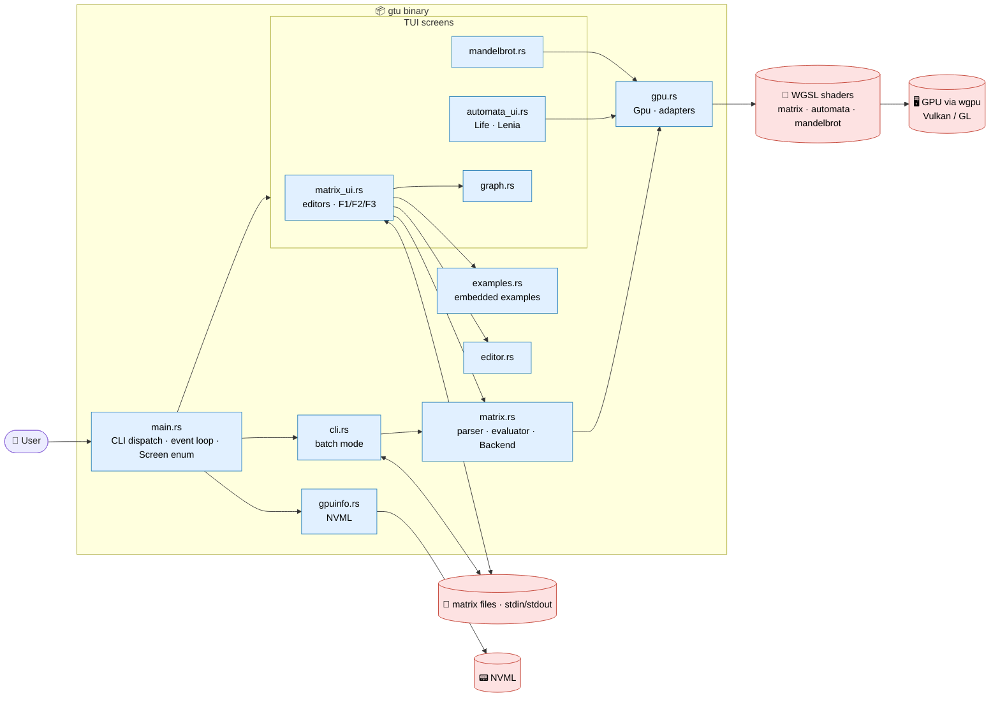

# 🏗️ Architecture & Source Map — GPU Task Executor (`gtu`)

-4285F4)

*In-depth map of the `src/` tree*

> [!NOTE]
> Build/test commands live in [`.github/copilot-instructions.md`](.github/copilot-instructions.md) and [`AGENTS.md`](AGENTS.md); user docs in [`README.md`](README.md) and [`examples/README.md`](examples/README.md).
> Paths below are relative to `src/` unless stated otherwise.

## 📑 Table of contents

1. [🎯 What this app is](#1--what-this-app-is)
2. [🧭 High-level architecture](#2--high-level-architecture)
3. [🚀 Startup & event loop](#3--startup--event-loop)
4. [🖥️ GPU layer](#4--gpu-layer)
5. [🧮 Matrix calculator](#5--matrix-calculator)
6. [⌨️ CLI (no UI)](#6--cli-no-ui)
7. [📚 Bundled examples](#7--bundled-examples)
8. [🕸️ Graph & image views](#8--graph--image-views)
9. [🧬 Cellular automata & Mandelbrot](#9--cellular-automata--mandelbrot)
10. [🛠️ Build, dependencies & CI](#10--build-dependencies--ci)
11. [🧪 Tests](#11--tests)
12. [⚠️ Gotchas & conventions](#12--gotchas--conventions)

---

## 1. 🎯 What this app is

A **Rust terminal app** that runs compute workloads on the GPU through `wgpu` (WGSL shaders). One binary, **`gtu`**, has two faces:

- 🖥️ **Interactive TUI** (`ratatui`) — Mandelbrot explorer, Game of Life, Lenia, a **matrix calculator**, bundled matrix examples and a GPU picker.
- ⌨️ **Batch CLI** (`clap`) — the same matrix calculator without UI, pipe-friendly (`gtu -i m.txt -e expr.txt | gtu -i - -e next.txt`).

Key facts:

- A single `Gpu` (device, queue, adapter info) is created at startup and shared by every screen; `-g INDEX` / the *Select GPU* screen choose the adapter.
- Every matrix operation is **one GPU compute dispatch**; state of the automata stays on the GPU and is read back only for drawing.
- NVML telemetry (utilization, VRAM, temperature, power) is shown in a header above every screen and falls back to "unavailable".
- No persistence besides user-chosen files (matrix input/result files).

---

## 2. 🧭 High-level architecture

Key cross-cutting ideas:

1. **One shared `Gpu`** — created once, passed by reference to screens and to the CLI.
2. **`Backend` trait** — the evaluator talks to a `Backend` (`binary`, `transpose`); `Gpu` implements it, tests use a CPU implementation.
3. **Same engine for UI and CLI** — `matrix::evaluate(defs, expr, backend)` is the single entry point.
4. **Text in, text out** — results are `result = [..]`, valid as the next run's input, which makes piping work.
5. **Examples are data** — `examples/**/*.txt` embedded with `include_str!`, runnable from UI and CLI.

---

## 3. 🚀 Startup & event loop

| File | Role |
|---|---|
| `main.rs` | Parses `cli::Cli`; if `is_batch()` runs `cli::run` and exits, otherwise starts the TUI via `app(terminal, gpu_index)`. Holds the `Screen` enum, the `MENU`, the F1 help overlay and the GPU header. |
| `gpuinfo.rs` | `Monitor::sample()` wraps NVML; sampled at most once per second, errors become "unavailable". |

`Screen` variants: `Menu`, `Mandelbrot(View)`, `Setup(Setup)`, `Run(Run)`, `Gpus(..)`, `Matrix(MatrixUi)`.

Menu entries: **Mandelbrot · Game of Life · Lenia · Matrices · Matrix examples · Select GPU · Exit**.

- Loop: draw → poll events (~33 ms frame) → route the key/mouse event to the active screen.
- **F1** opens the context help everywhere (`h` too, except in the Matrices editor where it is text).
- Ctrl+C/X/V arrive as `Char` events with the CONTROL modifier in raw mode.

---

## 4. 🖥️ GPU layer

| File | Role |
|---|---|
| `gpu.rs` | `Gpu { device, queue, adapter info }`; `Gpu::new()` (automatic high-performance adapter), `Gpu::with_adapter(i)`, `list_adapters()`. `Gpu::run` (vecadd/saxpy/square, `shader.wgsl`) is currently unused. |
| `shader.wgsl` | Legacy vecadd/saxpy/square kernel. |

Adapters on a typical dev machine: Intel UHD, NVIDIA (Vulkan), llvmpipe (CPU), NVIDIA (GL) — listed with `gtu --list-gpus`.

---

## 5. 🧮 Matrix calculator

### 5.1 `matrix.rs` + `matrix.wgsl`

| Piece | Description |
|---|---|
| `Matrix { rows, cols, data }` | Row-major `f32`; a scalar is a 1×1 matrix. |
| `parse_definitions` / `parse_into` | `NAME = [1 2; 3 4]` (brackets optional), `include path`, `output path`, `graph NAME` (directives), `I = image path\|builtin:earth`, `#` comments. |
| `split_input`, `output_path`, `graph_name` | Extract the `# expr:` default expression and directives. |
| Tokenizer/Parser → `Expr` | `+ - *`, unary `-`, `'` (transpose), parentheses, function calls; arguments are full expressions. |
| `eval` | Evaluates `Expr` through a `Backend`; `+`/`-` broadcast a number over a matrix; `*` with a 1×1 operand scales. |
| `transformation()` | `rot rotx roty rotz scale shearx sheary reflect proj identity ones smooth flip` (degrees, column vectors). CPU-side calls in `eval`: `rows cols resize raycast astar bfs`. `det`/`trace` reduce a matrix to a number; one vector argument expands into several (`scale(v)`). |
| `Gpu::dispatch(op, a, b, rows, cols, inner)` | One dispatch, workgroup size 64; ops: `0 add · 1 sub · 2 matmul · 3 transpose · 4 scale by b[0]`; limit `MAX_ELEMENTS = 64 * 65535`. |
| File I/O | `expand_tilde` (`~` in every path), `load_input` (text, maze `.zip` → `input.txt`, image → `I = image PATH`), `main_size`/`remap_sizes` (fit expression sizes to an opened matrix), `save_png`, `back_expression` (`# back:` line), `evaluate_vars`,  `save_input` (expression stored as `# expr:`), `save_result` (`result = [..]`), `result_text`, `clean_expression`. |
| `load_image` | PNG/JPEG → grayscale matrix, at most 128 px per side; `builtin:earth` is a bundled NASA photo (`examples/lighting/earth.png`). |

> [!IMPORTANT]
> `matrix.wgsl` is the only matrix kernel; adding an operation means a new `op` code there **and** in `Backend for Gpu`, plus the CPU test backend.

### 5.2 `matrix_ui.rs` (the *Matrices* screen)

- Two editors (`Editor`): **definitions** (multi-line, capped at 35 % of the window height and scrollable) and **expression** (single line).
- Result pane: numbers (scrollable with `PgUp/PgDn`, `Ctrl+arrows`), a **graph** next to it (`graph NAME`), or **before/after** pictures for image-sized results.
- Keys: `Tab` switch · `Enter`/`F5` calculate · `Ctrl+C/X/V/A` clipboard · `Ctrl+S/O/R` save input / open (txt, maze zip, image) / save result · `Ctrl+E` export (maze zip or image PNG only) · `Ctrl+N`/`Ctrl+P` feed the result back as input and apply the forward / editable back expression (default back restores the previous result exactly) · `F1` help · `F2` examples picker · `F3` expression help · `Esc` back.
- `Clip` uses the system clipboard (`arboard`, Wayland data-control) and falls back to an internal buffer.
- A third editor (back expression) appears for image results; the result title shows `example | opened file`.
- Prompts (`Prompt::Save | SaveResult | Export | Open`) reuse `Editor` for the path.

### 5.3 `editor.rs`

Minimal text buffer: cursor, Shift-selection, Home/End, multi-line editing, `cursor_line()` for scrolling, `lines(focused)` rendering with the cursor/selection styles.

---

## 6. ⌨️ CLI (no UI)

`cli.rs` (clap derive, binary name `gtu`):

| Option | Meaning |
|---|---|
| `-i, --input` | File, `-` (stdin) or **inline text** with definitions. |
| `-e, --expression` | File, `-` or inline expression; default is the `# expr:` line of the input. |
| `-o, --output` | Result file; otherwise stdout. |
| `-g, --gpu INDEX` / `-l, --list-gpus` | Choose / enumerate adapters (`-g` alone selects the GPU for the UI). |
| `--list-examples`, `--example N\|TITLE`, `--show-example` | Bundled algorithms. |

Details:

- A value that is not `-`, not an existing file and does not look like a file name is treated as **inline text**; `\n` separates lines.
- Without `-i` on a terminal, the input is empty (no stdin wait).
- Errors go to stderr with exit code 1; results are `result = [..]` so runs chain via pipes.

---

## 7. 📚 Bundled examples

`examples.rs` holds the `EXAMPLES` table (`example!(title, dir, defs, expr)`), embedding `examples/<dir>/*.txt` with `include_str!`.

| Folder | Content |
|---|---|
| `examples/markov/` | `chain.txt` + `two_days`, `steady` |
| `examples/graph/` | `graph.txt` + `degrees`, `neighbors`, `walks3`, `reach3` |
| `examples/lighting/` | `scene.txt` (shading, moved light) and `photo.txt` + `photo_raycast`, `photo_enhance`, `photo_blur`, `photo_lift`, sharpen/edges/negative/scale/mirror/rotate |

Available from the main menu, `F2` in the Matrices screen and `gtu --example`. A test evaluates every example on the GPU.

---

## 8. 🕸️ Graph & image views

- `graph.rs` — `Graph::from_matrix` (square, ≤ 200 nodes, edge where the entry ≠ 0), **Fruchterman–Reingold** layout starting from a circle, drawn with ratatui `Canvas` (edges, arrowheads, labels, weights; vector results highlight nodes).
- `matrix_ui.rs::draw_picture` — grayscale half-block (`▀`) rendering with fg/bg colors, aspect-ratio preserving; used for the **Before / After** view when the result is ≥ 8×8 and matches the shape of a definition (`I` preferred).

---

## 9. 🧬 Cellular automata & Mandelbrot

| File | Role |
|---|---|
| `automata.rs` + `automata.wgsl` | Game of Life and Lenia on ping-pong storage buffers; `Automata::{new, spawn, step, read}`. Both entry points share one bind-group layout, so `life` must reference the `kernel` binding. |
| `automata_ui.rs` | Setup form and run screen; grid follows the terminal (Life: braille 2×4 cells/char, Lenia: half blocks 1×2); resize restarts; patterns spawn at the mouse pointer (random if outside the grid). |
| `mandelbrot.rs` + `mandelbrot.wgsl` | Per-pixel iteration counts, cached by (width, height, view). |

---

## 10. 🛠️ Build, dependencies & CI

- `cargo build`, `cargo run` (needs a real terminal), `cargo test`.
- Binary name `gtu` via `[[bin]]` in `Cargo.toml` (package `gpu-task-executor`, edition 2024).
- macOS: Metal backend, needs only the Xcode command line tools (see README).
- Main crates: `wgpu`, `pollster`, `bytemuck`, `ratatui`, `clap`, `anyhow`, `rand`, `nvml-wrapper`, `arboard`, `image` (png + jpeg only).
- CI: `.github/workflows/rust.yml` runs `cargo build` and `cargo test` on pushes/PRs to `main`.

---

## 11. 🧪 Tests

`cargo test` (single: `cargo test blinker_oscillates_on_gpu`). GPU tests return early (pass) when no adapter is available.

| Area | Tests |
|---|---|
| `matrix.rs` | CPU backend vs GPU, parsing/errors, transformations, composition in arguments, files/includes, graph directive, bundled examples |
| `matrix_ui.rs` | clipboard, F3 help, scroll keys, photo before/after |
| `editor.rs`, `graph.rs` | editing, layout |
| `cli.rs` | options, inline values, example lookup, file → file run |
| `examples.rs` | every example evaluates on the GPU |
| `automata.rs`, `automata_ui.rs` | blinker, Lenia range, spawn, mouse target |

---

## 12. ⚠️ Gotchas & conventions

- **Never commit or push** from the assistant; commit messages are prefixed with the branch name (max 10 lines).
- Keep it simple, don't over-engineer; add/update tests for each change.
- Raw terminals deliver Ctrl+C/X/V as `Char` + CONTROL; `h` cannot open help in the Matrices editor (it is typed text) — use **F1**.
- Add/sub need equal shapes unless one operand is a number.
- `Matrix` results are `f32`; printed values may show float noise (e.g. `0.8333329`).
- Image matrices are capped at 128 px per side; functions like `smooth(n)` must match the image size.
